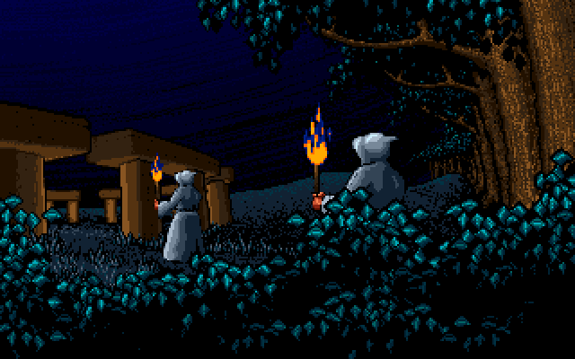
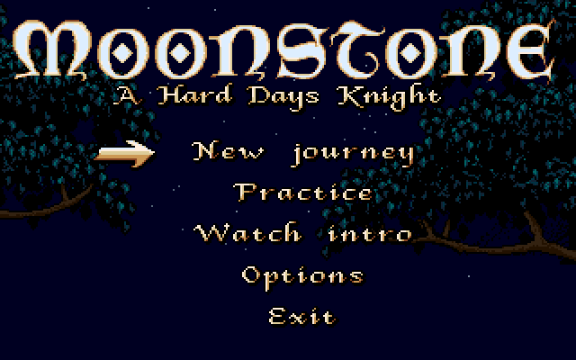
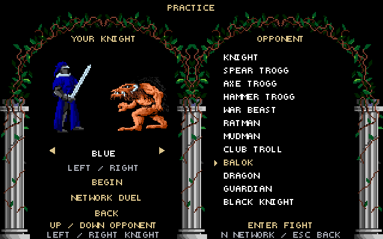
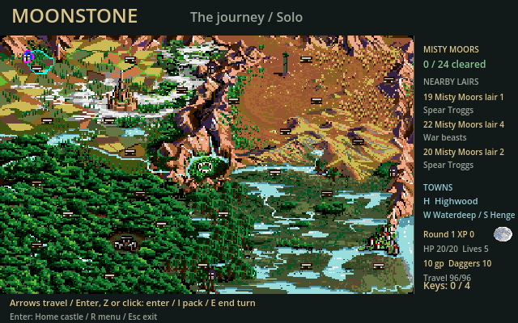
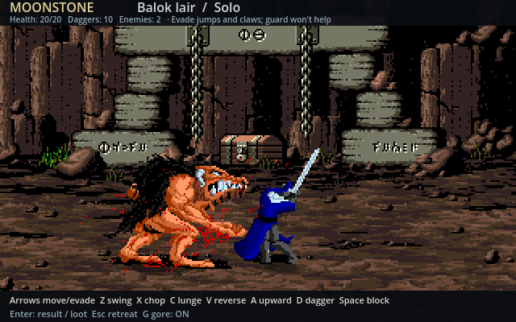
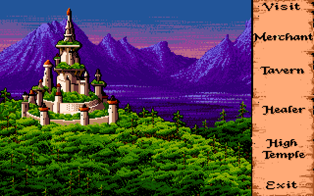
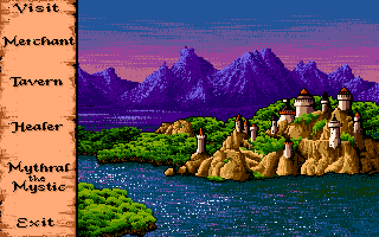
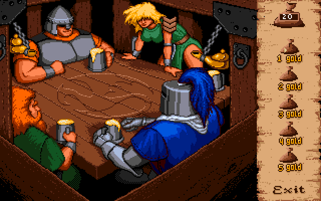

# Moonstone Remake

An unofficial native remake of **Moonstone: A Hard Day’s Knight (1991)** by
Craig Chandler, built with Godot for Linux and Windows.

The project recreates the original game’s combat and campaign while preparing
for replaceable graphics and gameplay content. It is a work in progress, not a
finished or fully accurate reproduction.

**This repository contains source code and documentation screenshots. Original
game data, runtime artwork/audio packs, reference footage and playable packages
are not included.**
Running the classic version requires a separately provisioned local asset set
or a one-time import from your own compatible original data. Disk images are
not needed during play.

## Screenshots

| Intro | Main menu |
| --- | --- |
| [](docs/screenshots/intro.png) | [](docs/screenshots/main-menu.png) |

| Practice menu | World map |
| --- | --- |
| [](docs/screenshots/practice-menu.png) | [](docs/screenshots/world-map.png) |

| Battle | Highwood |
| --- | --- |
| [](docs/screenshots/battle.png) | [](docs/screenshots/town-highwood.png) |

| Waterdeep | Tavern |
| --- | --- |
| [](docs/screenshots/town-waterdeep.png) | [](docs/screenshots/town-tavern.png) |

[Capture details and artwork attribution](docs/screenshots.md).

## Current game

- Native combat against the original creature roster, with directional sword
  attacks, throwing daggers, holds, deaths, gore options and sound.
- World travel, lairs, loot, equipment, experience, stat upgrades, towns and
  quest progression.
- Four knight identities, computer rivals, local human turns and human duels.
- Standalone practice against every native creature and knight opponent.
- Direct two-player network practice duels with host/join, readiness and rematches.
- Keyboard, mouse and configurable controller input; campaign save/continue.
- Native opening, menus, location scenes and ending sequences.

Campaign networking, internet matchmaking/relay, human cooperative encounters,
a public mod API and HD/3D renderers are future work. Some timings, movement and presentation remain native
adaptations. Automated checks do not establish complete original-game parity.

## Build and run

Development currently uses **Godot 4.6.1**, matching Linux/Windows export
templates, Python 3.11+ and Bash. Players of a locally built package do not need
these tools.

1. Provision the local native assets described in [development](docs/development.md),
   or follow the [one-time import](docs/importing.md).
2. Open `game/project.godot` in Godot, or build from the repository root:

   ```bash
   bash tools/build.sh --skip-import
   ```

3. Extract the resulting local ZIP from `outputs/`. Run `Moonstone.sh` on Linux
   or `Moonstone.cmd` on Windows. See the [player guide](docs/player-guide.md).

Without original assets, the dependency-free build-tool and publication checks
can still run:

```bash
python3 -m unittest discover -s tools/tests
python3 tools/check_public_tree.py --ref HEAD
```

## Project documentation

- [Architecture and deterministic gameplay](docs/architecture.md)
- [Artwork and renderer boundaries](docs/art-packs.md)
- [Build, test and export workflow](docs/development.md)
- [Screenshot gallery](docs/screenshots.md)
- [Original-data import](docs/importing.md)
- [Asset and distribution policy](docs/asset-policy.md)
- [Roadmap](docs/roadmap.md)
- [Contributing](CONTRIBUTING.md)
- [Third-party references and dependencies](THIRD_PARTY.md)

## Licence and attribution

New source code in this repository is licensed under [MIT](LICENSE). This does
not grant rights to the original Moonstone game, its title, artwork, music,
sounds or other separately licensed material. This project is not affiliated
with or endorsed by the original creators or rights holders.

The original game’s credits are retained in locally imported content.
[THIRD_PARTY.md](THIRD_PARTY.md) records reference projects and the separate
licences of optional import dependencies.
